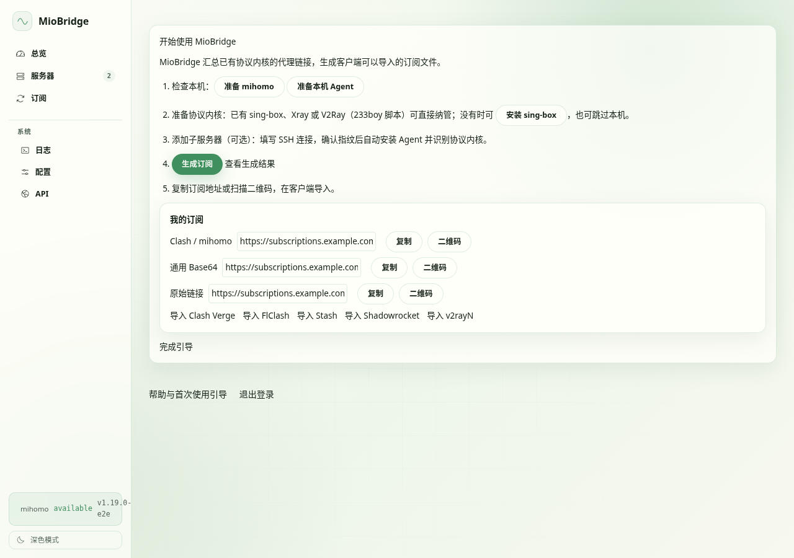
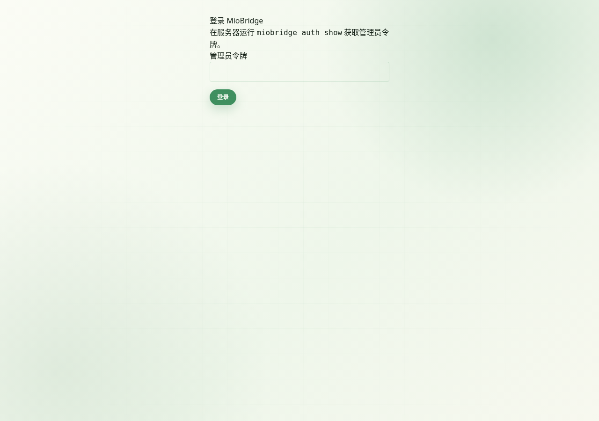
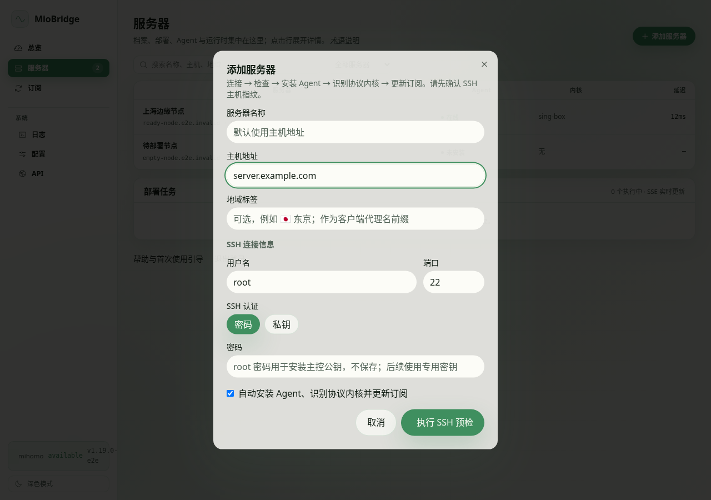
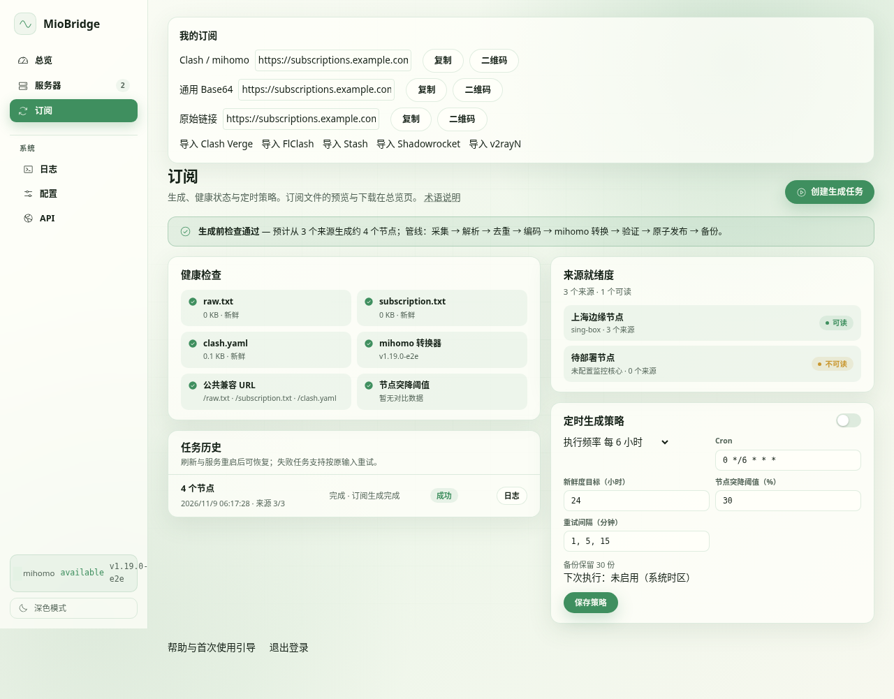
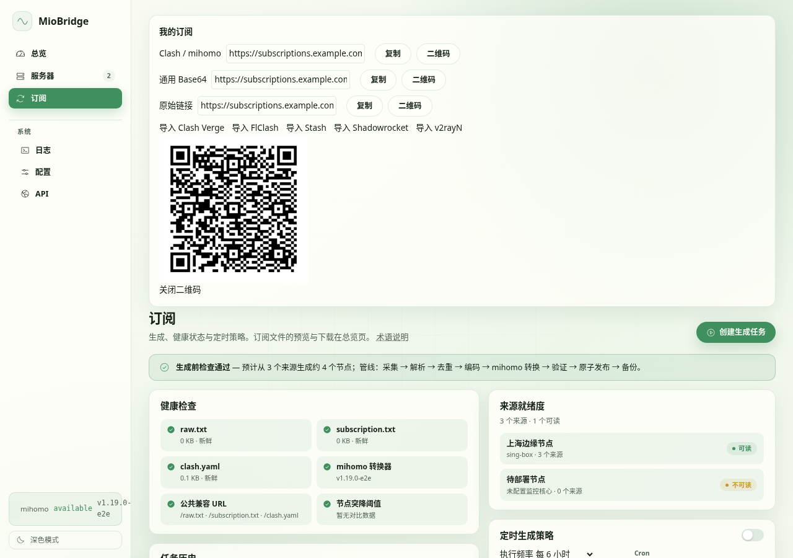

# 五步上手 MioBridge

截图来自隔离的浏览器回归环境，使用示例服务器和订阅数据；真实部署显示你的服务器名称、域名和代理节点。

## 1. 安装

```sh
curl -fsSL https://github.com/imal1/MioBridge/releases/latest/download/install.sh -o install.sh
sh install.sh
miobridge doctor
```

安装器准备依赖并启动控制台。主控可同时作为本机服务器，也可以使用 `--no-local-node` 只汇总远端来源。安装完成后按控制台引导继续。



## 2. 打开控制台并登录

运行 `miobridge dashboard url` 获取地址，`miobridge auth show` 查看管理员令牌。浏览器输入令牌登录。需要开放控制台端口（默认 3000）和云安全组，推荐公网使用 HTTPS。



## 3. 添加服务器

进入“服务器”→“添加服务器”，填写主机和 SSH 凭据。名称和地域标签可选。确认预检结果和指纹后，默认自动安装 Agent、检测协议内核、纳管并生成。没有协议内核时选择安装 sing-box/Xray/V2Ray；已有本机来源也可跳过添加远端。



## 4. 检查订阅生成

订阅页展示来源、缓存、任务阶段和生成结果。数量突降时查看差异，排查后再决定是否强制发布。可设置频率预设或高级 Cron，开关即时保存。



## 5. 导入客户端

先在配置页设置 `app.public_base_url` 为可访问的公网 HTTPS 地址。订阅页复制地址、扫描二维码或用客户端导入按钮；也可运行 `miobridge subscription url --qr`。新安装的链接包含独立订阅令牌，请不要公开分享。



后续问题见 [FAQ](FAQ.zh-CN.md)、[部署指南](DEPLOYMENT.md) 和 [故障排查](../TROUBLESHOOTING.zh-CN.md)。
